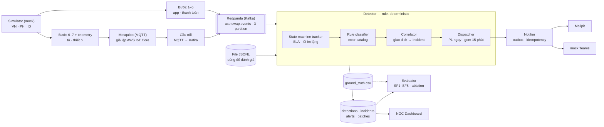

# Báo cáo Gate 1 – AI Agent kiểm tra giao dịch lỗi đổi pin VinFast (ASE)

Nov 11, 2026 · @Khang

- **Mã nguồn đo:** *baseline* `c92f61f` (detector chưa chỉnh theo tập `eval`) · *sau điều chỉnh* `db74476`. Ngày đo: 08/11/2026.
- **Dữ liệu:** mock do simulator sinh, có ground truth, 3 nước VN · PH · ID. **Cấu hình đo: rule-only** (chưa có LLM nên SF6, SF9 chưa đo).
- **Thuật ngữ:** *SF* = success factor (Gate 0 §3). *Ground truth* = nhãn đúng simulator ghi sẵn cho mọi phiên. *Incident* = nhóm giao dịch cùng một sự cố, để một sự cố chỉ ra một cảnh báo.

## 1. Tóm tắt

- **Chạy được từ đầu đến cuối:** simulator → MQTT / Kafka → detector (rule) → Mailpit và mock Teams → dashboard. Tập phiên phát hiện qua luồng này **trùng khớp 100%** với chạy trên file JSONL (`smoke` 58/58, `dev` 924/924).
- **Baseline rule-only** (tập test của `eval`: 15.091 phiên, 1.127 phiên lỗi, chưa từng dùng để chỉnh rule): **SF1–SF4 đạt** (recall 100%, precision 100%, phân loại đúng 99,0%); **SF5 cho P1, SF7 (đúng team), SF8 chưa đạt** (127,8 s; 99,0%; 3,40).
- **Giả định rủi ro nhất đã kiểm chứng:** tầng trường **T0+T1** (mã lỗi, tủ/khoang, trạng thái trừ tiền, provider) đủ để đạt SF2 ≥ 95% (100%) và SF4 ≥ 85% (96,3%). Thiếu T1 thì phát hiện được nhưng không phân loại được (SF4 = 0%). Đây là danh sách trường ưu tiên xin trong dữ liệu masked (mục 4).
- **Sau 2 điều chỉnh rule:** SF4 99,7%, SF7 99,7%, SF8 1,40, nhưng điều chỉnh được thiết kế sau khi xem các phiên sai trên `eval` nên **không còn hoàn toàn khách quan** (mục 3).
- **Lưu ý trung thực:** kết quả gần tuyệt đối vì mock có cấu trúc rõ (mọi lỗi đều có event FAILED/TIMEOUT hoặc quá SLA). Đây là cận trên, **không suy ra được kết quả trên dữ liệu thật**.
- **Sprint 1:** LLM triage và đo SF6/SF9, tập test mới, xử lý 3 phiên còn sai, chốt với mentor định nghĩa SF5 và SF8 (mục 6–7).

**Kết luận.** Báo cáo đáp ứng 5 yêu cầu của Gate 1 (skeleton, kiểm chứng giả định rủi ro nhất, kế hoạch điều chỉnh, baseline, backlog); 3 chỉ tiêu chưa đạt đều có nguyên nhân đã đo và hướng xử lý.

## 2. Skeleton end-to-end

Detector chỉ dùng một interface đọc event, nên đổi từ JSONL sang Kafka không phải sửa detector; JSONL dùng để **đánh giá** vì thứ tự event luôn giống nhau, Kafka/MQTT dùng cho `e2e` và trình diễn. Mọi timeout tính theo thời gian của event; khi đọc nhiều partition, đồng hồ chỉ tiến tới thời điểm *chậm nhất* của các partition còn dữ liệu (watermark) cộng 10 giây dung sai, để hai đường MQTT và Kafka đến lệch nhau không gây timeout giả.

**Lịch gửi:** P1 (an toàn, tiền, tài sản) gửi ngay đúng team; P2/P3 gom theo team mỗi 15 phút; lỗi người dùng gom gửi CSKH cùng chu kỳ. Báo cáo tổng hợp 18:00 hằng ngày làm ở Sprint 1.

| Lệnh | Việc |
|---|---|
| `make sim PROFILE=dev` · `make detect PROFILE=dev` | Sinh dữ liệu mock + ground truth · chạy detector trên JSONL |
| `make eval PROFILE=eval` · `make ablation` | Đo SF trên tập test → `data/eval/eval/report.md` · field ablation → `data/dev/ablation/report.md` |
| `make stream-up` / `stream-down` | Bật/tắt Redpanda + Mosquitto + Mailpit |
| `make e2e PROFILE=smoke` | Phát qua MQTT + Kafka → detector → Mailpit/mock Teams, tự dừng, so với JSONL |
| `make stream-demo PROFILE=demo SPEED=60` | Phát dữ liệu qua luồng, gửi cảnh báo thật để trình diễn; mở dashboard riêng bằng `make dashboard` (cổng 8000; Mailpit cổng 8025) |
| `make demo` | Dựng 3 incident mẫu từ phiên thật của profile `demo` (40 trạm) gửi qua notifier; **không đi qua detector** |
| `make check` | `ruff`, `mypy` (strict), `pytest`: 161 test, tất cả đạt (test tích hợp tự bỏ qua khi chưa bật broker) |

**Kiểm chứng luồng Kafka** (`make e2e`, 3 partition, phát nhanh 18.000×):

| Chỉ số | `smoke` | `dev` |
|---|---|---|
| Phiên phát hiện qua Kafka / qua JSONL | 58 / 58 | 924 / 924 |
| Độ trễ đến tối đa so với đồng hồ (ngưỡng 10 s) | 7,9 s | **9,4 s** (sát ngưỡng) |
| Event trùng · đến trễ đã xử lý | 31 · 37 | 1.400 · 1.947 |
| Alert P1 · tin gom (gửi lỗi) | 3 · 27 (0) | 9 · 555 (0) |
| Phát hiện muộn hơn JSONL tối đa (thời gian mô phỏng) | 21,7 s; 0/58 phiên chậm quá 60 s | **44,0 s** (1 phiên P1 `PAID_NOT_DELIVERED`); 10/924 phiên muộn hơn 10 s; 0 phiên chậm quá 60 s |
| Thời gian chạy | 27 s | 11 phút 3 giây (gồm gửi thật 555 tin gom) |

Tài nguyên khi cả 3 container chạy tải `dev`: Redpanda 356 MiB, Mosquitto 6 MiB, Mailpit 57 MiB (máy 15 GiB RAM).

**Giới hạn:** dung sai 10 s **không** chặn hết độ trễ do watermark chờ partition chậm (alert đến muộn tới 44 s) và độ trễ đến 9,4 s đã sát ngưỡng. Vì vậy **SF5 chỉ đo trên JSONL**; SF5 qua Kafka chưa đo (backlog việc 8). Tập phiên phát hiện và phân loại không bị ảnh hưởng (0 phiên khác nhóm hoặc incident).

**Kết luận.** Luồng MQTT + Kafka mô phỏng đúng kiến trúc mentor xác nhận, cho kết quả phát hiện giống hệt JSONL và nhẹ đủ chạy trên laptop; độ trễ phát hiện qua Kafka còn cần cải thiện.

## 3. Baseline metric (rule-only)

**Tập đo.** `eval`: 30 ngày, 11 trạm (VN 7, PH 2, ID 2), đo trên **10 ngày cuối** (split `test`): 15.091 phiên (VN 10.535 · PH 2.600 · ID 1.956), **1.127 phiên lỗi** (SYSTEM 320 · HARDWARE 142 · PAYMENT 99 · BUSINESS 112 · USER 394 · BATTERY_QUALITY 60), 25 lần xuất hiện của 11 scenario (mỗi scenario ≥ 2 lần). Seed test 9042 khác seed `dev` 1042. Scenario test được khoá trước khi viết rule; detector viết và chỉnh trên `dev`/`smoke`, `eval` chạy lần đầu để lấy baseline. Kết quả chính thức của Gate 1 là cột **Baseline**.

| SF | Chỉ số | Ngưỡng | **Baseline** | Sau điều chỉnh | Kết luận (baseline) |
|---|---|---|---|---|---|
| SF1 | event xử lý / event khác nhau · phiên thấy / phiên có nhãn | 100% | 100% (306.628/306.628) · 100% (44.974/44.974) | như baseline | đạt |
| SF2 | recall (riêng lỗi im lặng) | ≥ 95% | 100% (1.127/1.127) · 100% (43/43) | như baseline | đạt |
| SF3 | precision; phiên bẫy `pending_then_ok` bị báo nhầm | ≥ 90% | 100% (1.127/1.127); 0 phiên | như baseline | đạt |
| SF4 | accuracy (macro-F1) | ≥ 85% | **99,0%** (99,2%) | 99,7% (99,6%) | đạt |
| SF5 | P1: p95 từ lỗi → alert | < 60 s | **127,8 s** (5/5 incident P1 có alert) | 127,8 s | **chưa đạt** |
| SF5 | P2/P3/USER: tới tay team trong 1 chu kỳ 15 phút | ≤ 15 phút | 100% (tối đa 900,0 s) | như baseline | đạt (do thiết kế gom) |
| SF7 | đúng team | 100% | **99,0%** (1.094/1.105) | 99,7% (1.092/1.095) | **chưa đạt** |
| SF7 | hợp lệ schema · đủ mã GD + giờ địa phương | 100% | 100% · 100% (545/545) | 100% · 100% (535/535) | đạt |
| SF8 | alert P1 / incident P1 thật | ≤ 1,2 | **3,40** (17/5) | 1,40 (7/5); số phụ 1,00 | **chưa đạt** |
| SF6, SF9 | RCA đúng; an toàn (cần LLM) | ≥ 70%; 0 | chưa đo | chưa đo | Sprint 1 |

Trên `dev` (14.159 phiên, 924 phiên lỗi; tập dùng để chỉnh rule nên số cao hơn): baseline SF2 100% · SF3 100% · SF4 99,0% · SF5 P1 p95 122,5 s · SF7 99,0% · SF8 2,17 (13/6); sau điều chỉnh SF4 100% · SF7 100% · SF8 1,50 (9/6, số phụ 1,00), các chỉ số còn lại không đổi.

**Ba chỉ tiêu chưa đạt (theo baseline)**

- **SF5 cho P1 (127,8 s):** do `PAID_NOT_DELIVERED` (đã trừ tiền nhưng không nhả pin), lỗi im lặng chỉ lộ ra khi hết SLA 120 s của bước 6. Lỗi quá nhiệt được báo ngay (0 s). Đo trên `dev` (13.235 phiên không lỗi đã thanh toán): event đầu tiên của bước 6 đến muộn nhất 65 s sau thanh toán (trung vị 37 s); chờ 30 s thì 8.685 phiên bị báo nhầm, chờ 60 s thì 12, từ 66 s mới 0. Với dữ liệu hiện tại **không có ngưỡng nào vừa an toàn vừa dưới 60 s** (câu hỏi 1).
- **SF7 đúng team (99,0%):** 11 dòng bị gửi nhầm IT Ops vì chưa phân loại được: 8 phiên `step_timeout` (đúng ra Field Ops), 2 `thermal_overload` (Battery Ops), 1 `peak_no_charged_battery` (Business Ops). Sau điều chỉnh còn 3.
- **SF8 (3,40):** correlator tách một sự cố thành nhiều alert: `PAID_NOT_DELIVERED` tách theo provider (13 alert cho 3 sự cố), `thermal_overload` 4 alert cho 2 sự cố. Sau điều chỉnh còn `thermal_overload` báo 2 team (Battery Ops và Field Ops) ở 2 trạm, về vận hành là hợp lý; nếu coi *1 sự cố thật = (scenario, nhóm lỗi)* thì SF8 = 1,00 (câu hỏi 2).

**Hai điều chỉnh sau baseline:** (1) phiên kẹt quá SLA ở bước 6–7 không có mã lỗi, đã biết tiền chưa bị trừ, được quy cho thiết bị tủ; nếu callback thanh toán chưa về thì vẫn `UNKNOWN`, vì có thể là `PAID_NOT_DELIVERED` có callback trễ. (2) `PAID_NOT_DELIVERED` gộp theo mã lỗi toàn mạng thay vì theo provider. Cả hai được thiết kế **sau khi xem các phiên sai trên `eval`**, nên ở CP1 sẽ sinh tập test mới (seed khác) để đo lại khách quan.

**Hai quyết định đo lường:** (a) mốc lỗi của incident P1 là phiên P1 *đầu tiên* (alert P1 không thể đến trước lỗi P1); tính từ phiên sớm nhất của cả scenario thì `dev` ra p95 = 179,5 s, còn `eval` ra cùng số. (b) 578 phiên lỗi nền trên `eval` (572 trên `dev`) không có mốc `injected_at`; dùng thời điểm event lỗi, vì ở 331 phiên scenario có lỗi tường minh trên `dev` hai mốc này trùng nhau (chênh 0,0 s).

**Kết luận.** Phát hiện và phân loại đạt xa ngưỡng; cảnh báo chưa đạt ở 3 điểm cụ thể đã biết nguyên nhân, trong đó SF5 cần mentor xác nhận về dữ liệu thật.

## 4. Kiểm chứng giả định rủi ro nhất (field ablation)

**Giả định (Gate 0 §8):** *với các trường mà hệ thống vận hành thật có, rule + correlator phân loại đúng nhóm lỗi với SF4 ≥ 85%.* Schema dữ liệu masked chưa có, nên kiểm trên `dev`: chạy rule-only với 4 tập trường theo tầng; rule thiếu trường tự tắt, không gây lỗi.

| Tập trường | SF2 | SF2 lỗi im lặng | **SF4** | SF4 theo nhóm (recall) | `UNKNOWN` | Rule tắt | SF4 sau ĐC |
|---|---|---|---|---|---|---|---|
| `T0` | 100% | 100% | **0,0%** | cả 6 nhóm 0% | 924 | 11/11 | 0,0% |
| `T0+T1` | 100% | 100% | **96,3%** | SYS 100 · HW 86 · PAY 100 · BIZ 76 · USR 100 · BAT 97 | 33 | 9 | 97,3% |
| `T0+T1+T2` | 100% | 100% | **98,4%** | SYS 100 · HW 86 · PAY 100 · BIZ 100 · USR 100 · BAT 100 | 15 | 5 | 99,4% |
| `ALL` (T0–T3) | 100% | 100% | **99,0%** | SYS 100 · HW 92 · PAY 100 · BIZ 100 · USR 100 · BAT 100 | 9 | 0 | 100% |

1. **Tầng tối thiểu đạt cả hai ngưỡng là `T0+T1`** (SF2 100%, SF4 96,3%): giả định **đứng vững trên mock**, với điều kiện dữ liệu masked có tầng T1.
2. **Phát hiện chỉ cần T0** (mọi lỗi đều có event FAILED/TIMEOUT hoặc quá SLA), nhưng **phân loại cần T1**: thiếu T1 mọi phiên là `UNKNOWN`.
3. **Nhóm nào cần tầng nào:** năm nhóm đạt ≥ 85% từ `T0+T1`. **BUSINESS cần T2** (76% → 100%): phiên thiếu mã lỗi chỉ phân loại được khi biết người dùng nợ cước hay hết hạn gói (`user_id`). **HARDWARE** lên 92% ở `ALL` nhờ telemetry T3.

**Trường cần xin trong dữ liệu masked**, xếp theo mức tăng SF4 của tầng chứa nó (T1 +96,3 điểm %, T2 +2,1, T3 +0,6). Cột nguồn là **đề xuất theo luồng mentor xác nhận, cần mentor xác nhận**:

| Ưu tiên | Trường (tầng) | Dùng để | Nguồn dự kiến |
|---|---|---|---|
| 1 | `error_code`, `payment.captured`, `payment_provider` (T1) | Tra danh mục lỗi → nhóm, mức; phát hiện đã trừ tiền không nhả pin (P1); khoanh vùng sự cố theo provider | Microservice (Kafka) |
| 1 | `cabinet_id`, `slot_id` (T1) | Khoanh vùng tủ/khoang, gộp incident thiết bị | Thiết bị (MQTT) |
| 2 | `user_id` hash (T2) | Nợ cước, hết hạn gói (BUSINESS) | Microservice (Kafka) |
| 2 | `lot_id`, `soh` (T2) · `battery_id`, `soc` (T2) | Lô pin SOH thấp · định danh pin, pin xuất SOC thấp | ERP/MES · Thiết bị (MQTT) |
| 3 | `door_state`, `battery_detected`, `heartbeat_at`, `temperature` (T3) | Kẹt cửa, cảm biến khoang, mất kết nối tủ, quá nhiệt (P1) | Thiết bị (MQTT) |
| — | `app_version`, `latency_ms` (T2), `hw_error_code` (T3) | Chưa có rule dùng; giữ làm bằng chứng cho LLM (SF6) | Microservice · Thiết bị |

Trường bắt buộc (T0): `session_id`, `occurred_at`, `step`, `status`, `station_id`, `country`, `timezone`.

**Giới hạn:** chạy theo *tầng*, chưa tách từng trường (chưa biết riêng `error_code` đóng góp bao nhiêu); mock có khoảng 10% phiên lỗi cố ý thiếu `error_code`, dữ liệu thật có thể thiếu nhiều hơn; mức tăng +96,3 điểm của T1 lớn vì `T0` không có trường nào để phân loại; mock sạch nên đây là cận trên.

**Kết luận.** Tầng T1 (5 trường) là đủ để đạt ngưỡng phân loại trên mock; ưu tiên xin T1, sau đó `user_id`.

## 5. Điều chỉnh so với Gate 0

| Gate 0 nói | Gate 1 làm | Lý do |
|---|---|---|
| Mail qua MailHog (§2, §4) | **Mailpit** | Thay công cụ hộp thư thử, chức năng giữ nguyên |
| JSONL giai đoạn đầu; Kafka từ điểm tích hợp I2 (§4, §6.3) | **Thêm MQTT (Mosquitto) + Kafka (Redpanda) ngay ở Gate 1**; JSONL vẫn là chuẩn đánh giá; 3 container Docker | Mentor xác nhận luồng BSS: thiết bị (CAN/RS485) → MQTT/AWS IoT Core → Kafka → microservice. Watermark để hai đường lệch nhau không gây timeout giả |
| Cảnh báo < 60 s (§1); SF5 p95 < 60 s chung (§3) | **P1 gửi ngay; P2/P3 gom 15 phút theo team; USER gom gửi CSKH (team mới); SF5 < 60 s chỉ áp cho P1** | Theo ý mentor về lịch gửi; cần xác nhận (câu hỏi 3) |
| Profile `smoke`, `dev`, `eval` (§7) | Thêm **`demo`** (40 trạm, 3 ngày) | Chỉ để trình diễn, không dùng đo SF |
| Dashboard thống kê / log stream: phần của Võ Doanh Nhân (§2) | ASE có **NOC dashboard riêng** (tổng quan, trạm/tủ, giao dịch, thanh toán, pin, cảnh báo, metric, kiểm chứng với ground truth; tab Incident mới là chỗ giữ sẵn, làm ở Sprint 1), nền bản đồ **Vietmap**, lớp **43.297 tủ đổi pin VinFast thật** (chỉ hiển thị, không dùng đo SF; file không đưa vào repo) | Để OPS và người chấm quan sát kết quả của ASE; không thay log stream của đối tác (ASE theo giao dịch, đối tác theo hành vi trên log) |
| Correlator gộp giao dịch thành incident (§4, §7); cửa sổ gộp 5 phút (thiết kế ban đầu) | Cửa sổ **SYSTEM 15 phút**; `PAID_NOT_DELIVERED` **gộp toàn mạng**; timeout bước 6–7 không mã (đã biết chưa trừ tiền) → HARDWARE; lỗi USER tăng đột biến → incident cho IT Ops | Đo trên `dev`: khoảng cách giữa 2 lỗi liên tiếp của một lần deploy lỗi tới 11 phút, cửa sổ 5 phút tách thành 2–3 incident (Gate 0 §7 yêu cầu đúng 1). Cần xác nhận (câu hỏi 6) |
| Đo SF5 từ lúc lỗi (§3) | Mốc lỗi P1 = phiên P1 đầu tiên; phiên nền dùng thời điểm event lỗi | Mục 3 |
| Pair contract với Võ Doanh Nhân, tích hợp I1–I5 (§6) | **Giữ nguyên.** ASE chạy độc lập ở Gate 1 (đúng nguyên tắc mỗi bên chạy được khi bên kia ngừng) và đã ghi file `ase.anomaly.transaction.v0.jsonl` theo cấu trúc đã mô tả, làm sẵn điểm I2 một chiều; dấu hiệu trước khi fail thể hiện qua `latency_ms` | Việc tích hợp theo lịch của cặp |
| Triage Agent (LLM), anomaly EWMA, open point, feedback store (§4) | **Chưa có.** Nút feedback trên mock Teams ghi vào SQLite, chưa nối vào evaluator | Phạm vi Sprint 1 → CP1/CP2 |
| Chỉ tiêu | SF5 (P1), SF7 (đúng team), SF8 chưa đạt | Nguyên nhân ở mục 3, hướng xử lý ở mục 6 |

**Kết luận.** Ba điều chỉnh ảnh hưởng cách chấm là lịch gửi thông báo (SF5), thêm MQTT + Kafka, và cửa sổ gộp SYSTEM; cả ba cần mentor xác nhận ở mục 7.

## 6. Backlog Sprint 1 (tới CP1 18/11)

| # | Việc | SF | Tiêu chí xong |
|---|---|---|---|
| 1 | Triage LLM single-shot (Claude Haiku 5.5): context gom bằng code, structured output, validate evidence, cost guard, fallback rule khi LLM lỗi | SF6, SF9 | Cảnh báo đầu tiên vẫn gửi khi LLM lỗi (có test); evidence không tồn tại = 0; chi phí một lần `eval` ≤ $2 |
| 2 | Đo SF6, SF9 và bảng **rule-only vs rule + LLM** (Batch API) | SF1–SF9 | Báo cáo hai cấu hình, ghi `provider/model` và chi phí; SF6 ≥ 70%, SF9 = 0 / 0% / 0% |
| 3 | Sinh tập test mới (`test_seed` khác 9042) và đo lại | SF2–SF8 | Báo cáo trên tập chưa từng xem, ghi chênh lệch so với baseline |
| 4 | Giảm 3 phiên `UNKNOWN` còn lại trên `eval`: bất thường nhiệt theo tủ (EWMA) cho 2 phiên `thermal_overload` thiếu mã (49 °C, dưới ngưỡng 55 °C); xem lại cửa sổ gộp BUSINESS cho 1 phiên cách sự cố trước 12 phút | SF4, SF7 | Ba phiên được phân loại đúng; SF3 vẫn ≥ 90% |
| 5 | Chốt định nghĩa SF8 và cách đo SF5 của lỗi im lặng với mentor (câu hỏi 1–2); nếu giữ "theo scenario" thì gộp alert liên nhóm cùng sự cố; nếu có event mở khoang thì rút thời gian chờ | SF5, SF8 | SF8 ≤ 1,2 theo định nghĩa đã chốt; p95 P1 < 60 s trên tập test mới |
| 6 | Báo cáo tổng hợp 18:00 giờ VN; tab Incident; feedback API nối vào evaluator | SF7, open point | Có báo cáo ngày kèm CSV; feedback hiện trong evaluator |
| 7 | Context (telemetry, thanh toán) đọc từ stream; KPI dashboard cập nhật theo stream | SF5 | Dashboard tăng dần khi chạy `make stream-demo` |
| 8 | Watermark: chờ cho partition rảnh khi chạy thời gian thực, giảm số lần hỏi vị trí partition mỗi event; đo SF5 qua Kafka | SF5 | Phát hiện qua Kafka muộn hơn JSONL không quá 10 s trên `dev` (hiện tối đa 44,0 s); vẫn khớp JSONL |
| 9 | Ablation mức từng trường (ưu tiên `error_code`, `payment.captured`) | SF4 | Bảng đóng góp từng trường trong T1 |
| 10 | Khung adapter dữ liệu masked: ánh xạ YAML cột nguồn → trường T0–T3, báo cáo trường thiếu và tầng đạt được | SF1, SF4 | Chạy được trên fixture giả lập masked; có báo cáo coverage |

**Kết luận.** Việc 1–3 là đường găng của CP1; việc 4–5 giải quyết trực tiếp các chỉ tiêu chưa đạt.

## 7. Câu hỏi cho mentor

1. **Hệ thống thật có phát event ngay lúc bắt đầu bước 6 (lệnh mở khoang / nhả pin) không?** Hiện lỗi "đã trừ tiền nhưng không nhả pin" chỉ lộ ra sau 120 s (SLA bước 6) nên SF5 của P1 là 127,8 s; có event này thì phát hiện sớm hơn mà không báo nhầm.
2. **SF8: "một incident thật" tính theo scenario hay theo (scenario, nhóm lỗi)?** Sự cố quá nhiệt cần báo 2 team: theo scenario là 1,40 (chưa đạt), theo nhóm lỗi là 1,00.
3. **Có chấp nhận SF5 < 60 s chỉ áp cho P1**, còn P2/P3/USER tới tay team trong một chu kỳ gom 15 phút?
4. **Dữ liệu masked khi nào có, qua kênh nào, những trường nào?** Đặc biệt `error_code`, `payment.captured`, `cabinet_id` (tầng T1); có thể đối chiếu danh sách ở mục 4.
5. **Danh sách team và người nhận thật** để thay các team mô phỏng (IT Ops, Field Ops, Payment Ops, Business Ops, Battery Ops, CSKH).
6. **Có đồng ý cửa sổ gộp incident SYSTEM 15 phút** (thay vì 5 phút)?

**Kết luận.** Câu hỏi 1, 2 và 4 quyết định hướng sửa của Sprint 1; câu hỏi 3, 5 và 6 chỉ cần xác nhận.

## Phụ lục. Truy vết số liệu

`data/` không nằm trong git. Tái tạo: `make sim PROFILE=eval`, `make eval PROFILE=eval`, `make eval PROFILE=dev`, `make ablation`, `make e2e PROFILE=smoke`.

| Số trong báo cáo | File | Trường |
|---|---|---|
| Baseline `eval`/test, `dev` | `data/eval/eval/baseline/report.json`, `data/dev/eval/baseline/report.json` | `sf1.events_pct`, `sf2.recall`, `sf2.silent.recall`, `sf3.precision`, `sf4.accuracy`, `sf4.macro_f1`, `sf5.p1.overall.p95`, `sf5.batch.pct_within_interval`, `sf7.team_pct`, `sf8.ratio` |
| Sau điều chỉnh `eval`/test, `dev` | `data/eval/eval/report.json`, `data/dev/eval/report.json` | như trên, thêm `sf8.ratio_by_category`, `sf8.by_scenario` |
| Ablation (mục 4) | `data/dev/ablation/baseline/report.json`, `data/dev/ablation/report.json` | `rows[].sf2`, `rows[].sf4`, `rows[].n_unknown`, `rows[].disabled_rules`, `minimal_preset`, `first_ok_by_category`, `tier_gain_sf4` |
| Luồng Kafka | `data/smoke/stream/coverage.json`, `data/dev/stream/coverage.json` và dòng `[e2e]` của `make e2e` | `coverage.max_lateness_vs_clock_seconds`, `coverage.late_events_handled`, `n_p1_alerts`, `n_batches`, `send_errors` |
| Ngưỡng chờ bước 6; độ trễ phát hiện Kafka vs JSONL; tài nguyên | đo riêng trên `dev` (13.235 phiên không lỗi đã thanh toán) · so `data/<profile>/stream/detections.jsonl` với `data/<profile>/detections.jsonl` · `docker stats --no-stream` | — |

File baseline ghi `git_sha = bd02fcd` vì sinh ra trước khi commit `c92f61f`; số đã tái tạo từ đúng cây mã `c92f61f` và khớp hoàn toàn (trừ `git_sha`). Baseline `dev` chưa có trường `sf8.by_scenario` (thêm sau), các giá trị chung giống nhau. Các số "sau điều chỉnh" chạy lại ở `db74476` và không đổi.
