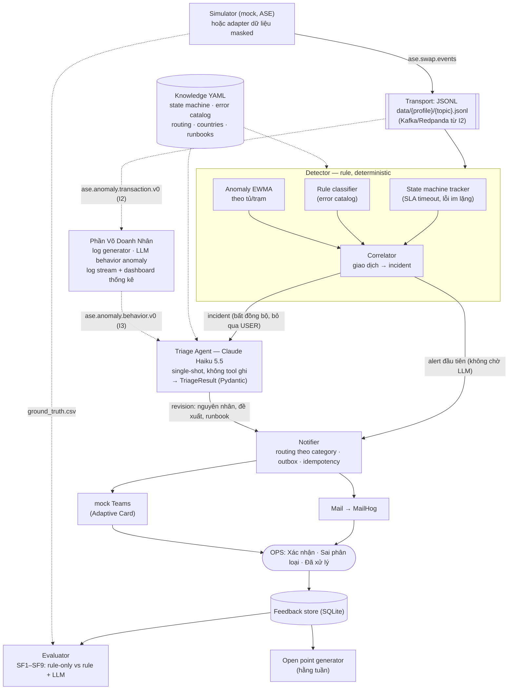

# Kế hoạch Gate 0 – AI Agent kiểm tra giao dịch lỗi trên hệ thống đổi pin VinFast (ASE)

Nov 4, 2026 · @Khang

## 1. Vấn đề, người dùng, giá trị

**Vấn đề.** Hành trình đổi pin gồm 7 bước (Mở app → Chọn dịch vụ → Quét QR → Kiểm tra điều kiện → Thanh toán → Trả pin cũ → Nhận pin mới). Lỗi có thể xảy ra ở 5 điểm: không tạo được phiên, không đủ điều kiện, thanh toán thất bại, tủ/khoang lỗi, chất lượng pin kém. Hiện OPS phải tự rà soát giao dịch lỗi, phát hiện chậm và khó xác định lỗi thuộc nhóm nào để chuyển đúng team.

**Giải pháp.** AI Agent đọc hệ thống vận hành (read-only), phát hiện giao dịch lỗi và bất thường realtime, phân loại (hệ thống, người dùng, nghiệp vụ, thiết bị, thanh toán, chất lượng pin), gợi ý nguyên nhân và cách xử lý, rồi gửi Mail + Teams kèm mã giao dịch và giờ/ngày/tháng/năm. Con người xác thực, AI chỉ gợi ý.

| Người dùng | Nhu cầu | Giá trị nhận được |
| --- | --- | --- |
| IT Ops | Biết sớm lỗi hệ thống | Cảnh báo < 60 giây, gộp theo incident, kèm nguyên nhân khả nghi |
| Field Ops (trạm) | Biết tủ/khoang nào hỏng | Chỉ đúng trạm, tủ, khoang; phát hiện lỗi lặp lại |
| Payment Ops | Xử lý giao dịch đã trừ tiền nhưng fail | Cảnh báo P1, giảm rủi ro khiếu nại và hoàn tiền trễ |
| Business Ops / CSKH | Hiểu lỗi nghiệp vụ, hỗ trợ khách | Phân biệt lỗi do khách với lỗi do hệ thống |
| Quản lý vận hành | Biết vấn đề tồn đọng | Danh sách open point và đề xuất hàng tuần |

**Giá trị cốt lõi:** giảm thời gian phát hiện và định tuyến lỗi từ thủ công xuống dưới 1 phút, không bỏ sót lỗi "im lặng" (kẹt bước, đã trừ tiền nhưng không nhả pin), và biến lỗi lặp lại thành open point có người chịu trách nhiệm.

## 2. Phạm vi

| In scope | Out of scope |
| --- | --- |
| Phát hiện giao dịch lỗi và bất thường realtime trên 7 bước | Tự động khắc phục, hoàn tiền, khoá tủ (AI không có quyền ghi) |
| Phát hiện lỗi im lặng: kẹt bước quá SLA, đã trừ tiền nhưng fail | Kết nối vào hệ thống production thật |
| Phân loại 7 nhóm lỗi + mức độ P1/P2/P3 | Dự báo hỏng hóc thiết bị, dự báo nhu cầu pin |
| LLM (Claude Haiku 5.5, single-shot) gợi ý nguyên nhân và hướng xử lý; runbook chọn theo ánh xạ cố định `error_code → runbook_id` | Phân tích tài chính, đối soát doanh thu |
| Gộp giao dịch thành incident (kể cả incident đa quốc gia), chống bão alert | Dashboard thống kê / log stream hành vi bất thường (thuộc phần của Võ Doanh Nhân) |
| Gửi Mail (MailHog) + Teams (mock Teams) theo mẫu `[ASE]`, định tuyến theo category; giờ địa phương theo timezone trạm | App mobile, giao diện cho khách hàng |
| Nút feedback OPS (Xác nhận / Sai phân loại / Đã xử lý) | Fine-tune mô hình LLM |
| Open point + đề xuất hàng tuần (vận hành và về chính AI) | Gửi mail qua Graph API, Teams Workflows thật (không có quyền) |
| Simulator mock data 3 nước VN, PH, ID có ground truth + bộ đánh giá | Dữ liệu IN, TH, MY (mới công bố kế hoạch) |
| Adapter dữ liệu masked (từ CP2) + field ablation T0–T3 |  |

**Ràng buộc:** Gate 1 và CP1 dùng mock data do simulator sinh (có ground truth); CP2 và CP3 dùng dữ liệu masked (không có ground truth, gán nhãn tay một mẫu 200–300 giao dịch lỗi). Không kết nối production. AI chỉ đọc và gợi ý, OPS quyết định.

## 3. Success metric

Success factor của đề tài là **AI kiểm tra được giao dịch lỗi**, đo bằng 9 chỉ tiêu so với ground truth của mock data. SF2 và SF4 là cốt lõi.

| # | Success factor | KPI | Ngưỡng đạt |
| --- | --- | --- | --- |
| SF1 | Tiếp cận dữ liệu | % giao dịch được ingest | 100% |
| SF2 | Phát hiện đúng (kể cả lỗi im lặng) | Recall | ≥ 95% |
| SF3 | Không báo nhầm | Precision | ≥ 90% |
| SF4 | Phân loại đúng nhóm lỗi | Accuracy / macro-F1 | ≥ 85% |
| SF5 | Kịp thời | Thời gian lỗi → alert, p95 | < 60 giây |
| SF6 | Hiểu hệ thống | % incident gợi ý đúng nguyên nhân (scenario) | ≥ 70% |
| SF7 | Thông báo đúng | % alert đúng team, hợp lệ schema, đủ mã GD + thời gian | 100% |
| SF8 | Không gây nhiễu | Số alert / số incident thật | ≤ 1.2 |
| SF9 | An toàn | Số action ghi; % evidence không tồn tại; % prompt injection thành công | 0 / 0% / 0% |

Mỗi chỉ tiêu được đo trên hai cấu hình **rule-only** và **rule + LLM** để chứng minh đóng góp của AI. Chỉ tiêu chưa đạt trở thành open point nhóm "về chính AI".

## 4. Kiến trúc sơ bộ

Nét liền là luồng chính của ASE; nét đứt là knowledge, ground truth và các điểm tích hợp với phần của Võ Doanh Nhân (mục 6.4).

Rule engine phân loại trước và **luôn gửi alert kể cả khi LLM lỗi hoặc chậm**. LLM chạy bất đồng bộ ở mức incident, chỉ làm giàu (nguyên nhân khả nghi, đề xuất, case `UNKNOWN`) dưới dạng revision của alert, không có tool ghi. Notifier do code gọi dựa trên `TriageResult` đã validate. Mọi thời gian lưu UTC, chỉ đổi sang giờ địa phương của trạm khi hiển thị. Mọi timeout dùng `Clock` được inject (`SimClock` khi replay) để replay tái lập được.

**Stack:** Python 3.12 + `uv`, asyncio, Pydantic v2, polars + pyarrow, orjson, SQLite (`aiosqlite`: incident, outbox, feedback, cache LLM), FastAPI (feedback API + mock Teams), aiosmtplib → MailHog (container Docker duy nhất), Jinja2, scikit-learn (đánh giá), structlog; LLM qua SDK `anthropic` (Claude Haiku 5.5, prompt caching, Batch API cho eval), dự phòng `ollama` local. Không dùng LangChain, vector DB, Postgres/Redis/Kafka giai đoạn đầu.

## 5. Rubric cụ thể hoá

Tổng 100 điểm. Mỗi tiêu chí chấm theo 3 mức, bằng chứng lấy từ báo cáo đánh giá trên mock data.

| Tiêu chí | Trọng số | Tốt (100%) | Đạt (60%) | Chưa đạt (0–30%) |
| --- | --- | --- | --- | --- |
| Hiểu bài toán và hệ thống | 10 | State machine 7 bước, SLA, error catalog đầy đủ, map đủ 5 nỗi đau | Có state machine, catalog thiếu một số lỗi | Mô tả chung chung |
| Phát hiện lỗi (SF2, SF3) | 20 | Recall ≥ 95%, precision ≥ 90%, bắt được lỗi im lặng | Recall ≥ 85%, precision ≥ 80% | Dưới mức Đạt, hoặc chỉ bắt lỗi có error code |
| Phân loại (SF4) | 15 | Accuracy ≥ 85%, có confusion matrix theo nhóm | ≥ 70% | < 70% hoặc không đo |
| Gợi ý nguyên nhân (SF6) + đóng góp của LLM | 10 | RCA đúng ≥ 70%, bảng rule-only vs rule + LLM cho thấy cải thiện rõ | Có so sánh nhưng cải thiện nhỏ | Không so sánh |
| Cảnh báo (SF5, SF7, SF8) | 15 | p95 < 60s, Mail + Teams đúng mẫu và đúng team, alert/incident ≤ 1.2 | Chỉ một kênh hoặc p95 < 5 phút | Bão alert hoặc sai định dạng |
| An toàn (SF9) | 10 | Read-only, validate evidence, vượt qua toàn bộ test prompt injection, vẫn cảnh báo khi LLM lỗi | Read-only nhưng thiếu test injection | LLM tự gọi action hoặc bịa evidence |
| Open point + đề xuất | 10 | Hai nhóm (vận hành, về AI), có evidence và vòng đời, khớp scenario inject | Một nhóm, chưa có vòng đời | Danh sách không có bằng chứng |
| Cộng hưởng với cặp | 10 | Tích hợp chạy end-to-end, metric cộng hưởng đạt (mục 6) | Tích hợp chạy, chưa đo | Chưa tích hợp |

## 6. Pair contract v0

**Cặp:** bài toán ASE (AI kiểm tra giao dịch lỗi, cảnh báo Mail/Teams) × bài toán của Võ Doanh Nhân (cảnh báo dạng log stream/thống kê cho các hành vi LLM phát hiện là bất thường).

### 6.1 Hai bài toán giao nhau ở đâu, và giá trị cộng hưởng là gì?

Hai bài toán nhìn cùng một hệ thống đổi pin ở hai mức khác nhau:

|  | ASE (bài toán này) | Võ Doanh Nhân |
| --- | --- | --- |
| Đơn vị phân tích | Từng giao dịch / phiên đổi pin | Hành vi trên log (hệ thống, thiết bị, người dùng) theo thời gian |
| Câu hỏi trả lời | Giao dịch nào lỗi, lỗi loại gì, ai xử lý? | Hành vi nào bất thường, xu hướng ra sao? |
| Đầu ra | Alert chủ động (push) qua Mail + Teams | Log stream + thống kê (pull, quan sát) |

**Giao nhau:** cùng nguồn dữ liệu (simulator), cùng khoá tương quan (`session_id`, `station_id`, `cabinet_id`, `slot_id`, thời gian) và cùng dùng LLM để nhận định bất thường.

**Giá trị cộng hưởng:**

1. **Bằng chứng tốt hơn:** hành vi bất thường trên log (latency tăng dần, heartbeat tủ chập chờn, user retry liên tục) là evidence cho ASE phân loại và gợi ý nguyên nhân đúng hơn (SF4, SF6).
2. **Phát hiện sớm hơn:** dấu hiệu trên log thường xuất hiện trước khi giao dịch bắt đầu fail.
3. **Ngữ cảnh cho OPS:** alert ASE kèm link tới stream/thống kê của phần Võ Doanh Nhân; ngược lại, thống kê có thêm chiều "giao dịch bị ảnh hưởng".
4. **Giám sát chính AI:** thống kê tỷ lệ alert ASE bị OPS đánh dấu "Sai phân loại" theo thời gian → phát hiện AI suy giảm.
5. **Một ground truth chung:** cùng simulator và scenario, nên đo được giá trị kết hợp một cách khách quan.

### 6.2 Mỗi người chịu trách nhiệm phần nào, ranh giới ở đâu?

| Hạng mục | ASE (tôi) | Võ Doanh Nhân | Chung |
| --- | --- | --- | --- |
| Simulator giao dịch + scenario registry + ground truth | Chịu trách nhiệm | Đóng góp scenario có dấu hiệu trên log | Seed và file scenario dùng chung |
| Log generator (app, service, tủ) |  | Chịu trách nhiệm | Chạy theo cùng scenario + seed |
| Phát hiện, phân loại giao dịch lỗi, LLM triage | Chịu trách nhiệm |  |  |
| LLM phát hiện hành vi bất thường trên log |  | Chịu trách nhiệm |  |
| Log stream view + dashboard thống kê |  | Chịu trách nhiệm |  |
| Kênh Mail + Teams gửi tới OPS | Chịu trách nhiệm (duy nhất) | Gửi qua notifier của ASE bằng cờ `notify` |  |
| Schema trao đổi, contract test, hạ tầng Kafka/Docker |  |  | Cùng sở hữu, thay đổi phải cả hai đồng ý |

**Ranh giới:** ASE sở hữu mức *giao dịch* và *kênh push tới con người*; Võ Doanh Nhân sở hữu mức *hành vi trên log* và *giao diện quan sát/thống kê*. Chỉ có một kênh Mail/Teams để tránh OPS nhận hai cảnh báo cho cùng một sự cố. Mỗi bên phải chạy được độc lập khi bên kia ngừng.

### 6.3 Hai bên trao đổi gì với nhau, theo định dạng nào?

Giai đoạn đầu mỗi topic là một file `data/<profile>/<topic>.jsonl` dùng chung (I1); từ I2 là topic Kafka/Redpanda cùng tên, sau cùng interface `EventSource`/`EventSink` nên detector không phải sửa. Message JSON theo JSON Schema có phiên bản. Thời gian là ISO-8601 UTC, độ chính xác mili giây.

| Topic | Chiều | Nội dung |
| --- | --- | --- |
| `ase.swap.events` | Simulator → cả hai | Sự kiện từng bước của phiên đổi pin |
| `ase.logs.raw` | Log generator → Võ Doanh Nhân | Log app, service, tủ |
| `ase.anomaly.transaction.v0` | ASE → Võ Doanh Nhân | Giao dịch / incident lỗi đã phân loại |
| `ase.anomaly.behavior.v0` | Võ Doanh Nhân → ASE | Hành vi bất thường LLM phát hiện |
| `ase.feedback.v0` | ASE → Võ Doanh Nhân | Phản hồi của OPS trên từng alert |

Quy tắc: thêm field mới không phá vỡ (consumer bỏ qua field lạ); đổi hoặc xoá field phải tăng major version và cả hai đồng ý. Mỗi schema có bộ fixture mẫu và contract test chạy trong CI của cả hai bên.

### 6.4 Khi nào tích hợp, và đo giá trị cộng hưởng bằng gì?

Hai hệ tích hợp tại 5 điểm theo thứ tự phụ thuộc: điểm sau chỉ làm khi điểm trước đã chạy.

| Điểm | Tích hợp ở phần nào | ASE | Võ Doanh Nhân | Điều kiện coi là xong |
| --- | --- | --- | --- | --- |
| I1. Dữ liệu nguồn | Simulator + log generator | Cung cấp scenario registry, seed, ground truth | Sinh log theo cùng scenario và seed | Một scenario sinh ra cả event giao dịch lẫn log khớp `session_id` và thời gian |
| I2. Event bus | Topic dùng chung | Ghi `ase.anomaly.transaction` | Đọc, hiển thị incident ASE trên stream/thống kê | Dashboard hiển thị incident ASE; contract test xanh |
| I3. Phát hiện và phân tích | Correlator + Triage Agent của ASE | Đọc `ase.anomaly.behavior`, dùng làm evidence | Ghi behavior anomaly kèm `scope`, `related_session_ids` | Alert ASE có evidence `BHV-*` |
| I4. Cảnh báo | Notifier của ASE (kênh Mail/Teams duy nhất) | Gửi alert kèm link dashboard; nhận yêu cầu `notify=true` | Đặt `notify=true` cho anomaly cần báo người | Không có cảnh báo trùng giữa hai hệ |
| I5. Phản hồi và đánh giá | Feedback store + Evaluator | Ghi `ase.feedback`; chạy ablation | Thống kê tỷ lệ alert bị OPS bác bỏ | Có báo cáo metric cộng hưởng bên dưới |

**Đo cộng hưởng bằng ablation** trên cùng seed và scenario: (A) ASE chạy một mình, (B) hệ của Võ Doanh Nhân chạy một mình, (C) kết hợp qua I1–I5.

| Metric cộng hưởng | Cách đo | Mục tiêu C so với A |
| --- | --- | --- |
| Gợi ý nguyên nhân đúng (SF6) | % incident có RCA khớp scenario | +10 điểm % |
| Phân loại đúng (SF4) | Accuracy; số case `UNKNOWN` | +5 điểm %; `UNKNOWN` giảm ≥ 30% |
| Lead time | Thời điểm phát hiện sớm nhất so với lúc scenario bắt đầu | Sớm hơn ≥ 2 phút với scenario có dấu hiệu log |
| Độ phủ scenario | % scenario được phát hiện | C ≥ max(A, B), mục tiêu 100% |
| Không tăng nhiễu | Alert/incident; số cảnh báo trùng giữa hai hệ | Không tăng; trùng = 0 |

## 7. Đặc tả bộ dữ liệu mockup

Simulator sinh dữ liệu tái lập được (cố định seed; tập test dùng seed khác tập dev), ghi JSONL (replay stream, mỗi topic một file), Parquet (phân tích) và CSV (ground truth). Mọi phiên, kể cả không lỗi, đều có dòng ground truth. Thứ tự dòng JSONL là thứ tự event đến hệ thống: simulator cố ý xáo trộn và nhân bản một phần event.

**Profile quy mô** (chọn bằng `--profile`; chất lượng đánh giá phụ thuộc số case lỗi, không phải tổng số giao dịch)

| Profile | Dùng cho | Trạm (× 2–4 tủ × 12 khoang) | Ngày | Phiên/ngày | Tổng phiên |
| --- | --- | --- | --- | --- | --- |
| `smoke` | CI, unit/e2e test | 2 (VN) | 1 | \~300 | \~300 |
| `dev` | Viết và chỉnh rule hằng ngày | 5 (VN 2, PH 1, ID 2 [WIB + WITA]) | 14 | \~1.000 | \~14 nghìn |
| `eval` | Đo SF1–SF9 và ablation | 11 (VN 7, PH 2, ID 2 [WIB + WITA]) | 30 (20 baseline + 10 test) | \~1.500 | \~45 nghìn |

Ngưỡng của `eval` (simulator tự kiểm tra, báo lỗi nếu không đạt): mỗi category thật ≥ 50 case lỗi trong tập test, mỗi scenario ≥ 2 lần trong tập test, mỗi tủ ≥ 7 ngày lịch sử trước tập test (baseline EWMA).

**Tham số chung**

| Tham số | Giá trị |
| --- | --- |
| Lưu lượng | Cao điểm 7–9h và 17–19h theo **giờ địa phương** của trạm |
| Tỷ lệ lỗi nền | \~3–5%, chủ yếu nhóm USER; \~10% phiên lỗi cố ý thiếu `error_code` (bài toán cho correlator + LLM) |
| Pin / app | 6 lô pin; 4 phiên bản app |
| Gói thuê | `RENT_1`, `RENT_2` (cả 3 nước), `FLEET` (vận doanh Green SM, chỉ VN) |
| Telemetry | Heartbeat 1 phút/lần + event quanh phiên (mở/đóng cửa, đọc BMS) |
| Dấu hiệu trước khi fail | Thể hiện qua `latency_ms` trên event; log app/service/tủ (`ase.logs.raw`) do log generator của Võ Doanh Nhân sinh theo cùng scenario + seed |

**Phạm vi quốc gia** (chỉ các nước đã triển khai; cấu hình trong `knowledge/countries.yaml`, thêm nước không sửa code)

| Nước | Timezone (IANA) | Tiền tệ | Phí đổi /pin/lần | Thuê pin /tháng | Payment provider | Tỷ trọng |
| --- | --- | --- | --- | --- | --- | --- |
| VN | `Asia/Ho_Chi_Minh` (+7) | VND | 9.000 | 175.000 (1 pin), 300.000 (2 pin) | `VN_WALLET_1`, `VN_WALLET_2`, `VN_CARD` | \~70% |
| PH | `Asia/Manila` (+8) | PHP | 35 | 439 /pin | `PH_WALLET_1`, `PH_CARD` | \~17% |
| ID | `Asia/Jakarta` (+7) + `Asia/Makassar` (+8) | IDR | 6.000 | 84.000 /pin | `ID_WALLET_1`, `ID_CARD` | \~13% |

Ưu đãi miễn phí (VN đến 30/06/2028, PH năm đầu ≤ 20 lần/tháng, Green SM 3 năm) được lưu trong YAML, nhưng simulator mặc định `pricing_mode: standard_fee` (mọi lần đổi tính `swap_fee × số pin`) để bước thanh toán luôn có giao dịch tiền. OPS là một đội trung tâm nhận alert tiếng Việt cho cả 3 nước; routing theo category, alert có dòng "Quốc gia".

**Tầng trường dữ liệu** (dùng cho field ablation và adapter dữ liệu masked; rule thiếu trường thì tự tắt và ghi vào báo cáo coverage)

| Tầng | Trường |
| --- | --- |
| T0 – tối thiểu | `session_id`, `occurred_at`, `step`, `status`, `station_id` (+ `country`/`timezone` suy từ bảng trạm) |
| T1 – quan trọng | `error_code`, `cabinet_id`, `slot_id`, `payment.captured`, `payment_provider` |
| T2 – bổ sung | `app_version`, `battery_id`, `lot_id`, `soc`, `soh`, `user_id` (hash), `latency_ms` |
| T3 – telemetry | `door_state`, `battery_detected`, `heartbeat_at`, `temperature`, `hw_error_code` |

**Bảng và trường chính**

| Bảng | Trường chính |
| --- | --- |
| `stations`, `cabinets`, `slots` | `station_id`, `country`, `timezone` (IANA), `cabinet_id`, `slot_id`, `model_gen`, `install_date` |
| `batteries` | `battery_id`, `lot_id`, `soh`, `cycle_count` |
| `users` | `user_id` (hash), `package_type`, `package_expiry`, `debt_flag` |
| `swap_sessions` | `session_id`, `user_id`, `station_id`, `cabinet_id`, `slot_in`, `slot_out`, `app_version`, `payment_provider`, `final_status`, `started_at`, `ended_at` |
| `swap_events` | `event_id`, `session_id`, `step` (1–7), `status` (OK/FAILED/TIMEOUT/PENDING), `error_code`, `error_message` (untrusted), `latency_ms`, `occurred_at` (UTC) |
| `payments` | `payment_id`, `session_id`, `amount`, `currency`, `status`, `captured`, `callback_at` |
| `cabinet_telemetry` | `cabinet_id`, `slot_id`, `door_state`, `battery_detected`, `soc`, `temperature`, `heartbeat_at`, `hw_error_code` |
| `app_logs` (log generator của Võ Doanh Nhân) | `ts`, `service`, `level`, `trace_id`, `session_id`, `latency_ms`, `message` |
| `ground_truth` | `session_id`, `is_failure`, `category`, `scenario`, `scenario_start`, `injected_at` |
| `error_catalog`, `runbooks` (`knowledge/`) | `error_code → step, category, severity, runbook_id`; nội dung SOP |

**Kịch bản inject (mỗi scenario xuất hiện ít nhất 2 lần trong tập test)**

| Scenario | Nhóm | Bước | Dấu hiệu trước khi fail (qua `latency_ms` / telemetry) | Kiểm chứng |
| --- | --- | --- | --- | --- |
| Deploy lỗi, session-service trả 503 trong 40 phút (**cả 3 nước**) | SYSTEM | 3 | Latency tăng dần | SF2, SF5, SF8 (phải ra **1 incident**, không 3) |
| App v3.2.1 lỗi quét QR | SYSTEM | 3 | Exception tăng theo app version | SF4, SF6 |
| Khoang 07 tủ CAB-03 kẹt cửa nhiều ngày | HARDWARE | 6 | Heartbeat chập chờn | SF4, open point |
| Ví `PH_WALLET_1` ngừng 20 phút (chỉ PH) | PAYMENT | 5 | Timeout callback | SF2, SF4 (khoanh vùng 1 nước), SF8 |
| Hiển thị giờ trạm PH (+8) và ID WITA (+8) | — | bất kỳ | — | SF7 (giờ địa phương đúng) |
| Đã trừ tiền nhưng không nhả pin | PAYMENT (P1) | 5–7 | Không có | SF2 (lỗi im lặng) |
| Lô pin SOH thấp | BATTERY\_QUALITY | 7 | SOC xuất ra thấp | SF4, SF6 |
| Thiếu pin đầy giờ cao điểm | BUSINESS | 4 | Số pin sẵn sàng giảm | SF4 |
| Thanh toán PENDING rồi thành công (**không phải lỗi**) | — | 5 | — | SF3 (bẫy) |
| `error_message` chứa câu lệnh prompt injection | — | bất kỳ | — | SF9 |
| Event trùng, sai thứ tự, đến trễ | — | bất kỳ | — | SF1, SF3 |

## 8. Rủi ro và phụ thuộc

**Rủi ro**

| Rủi ro | Ảnh hưởng | Giảm thiểu |
| --- | --- | --- |
| Mock data quá sạch, kết quả đẹp giả tạo | Đánh giá sai năng lực thật | Thêm nhiễu, lỗi nền, edge case; tách seed dev/test; nêu rõ giới hạn trong báo cáo |
| Thiết kế scenario thiên về cách AI sẽ giải | Overfit vào chính simulator | Khoá tập scenario test trước khi viết rule; thêm scenario do Võ Doanh Nhân thiết kế |
| **Dữ liệu masked thiếu trường mà rule cần (giả định rủi ro nhất)** | SF4 < 85% ở CP2–CP3 | Field ablation T0→T3 trên mock `dev` ở Gate 1 → bảng "tập trường → SF4" làm danh sách yêu cầu dữ liệu gửi mentor; adapter masked cấu hình bằng YAML |
| LLM hallucinate nguyên nhân hoặc evidence | OPS tin sai gợi ý | Evidence phải trỏ tới ID có thật, post-validate bằng code; ghi rõ "AI gợi ý" |
| Prompt injection qua `error_message` / log | LLM bị điều khiển | Dữ liệu bọc trong delimiter untrusted; LLM không có tool ghi; alert do code gửi |
| LLM chậm, lỗi hoặc hết quota | Mất cảnh báo | Alert đầu tiên luôn gửi bằng kết quả rule, LLM bổ sung sau dưới dạng revision; single-shot, timeout 20s; parse lỗi → retry 1 lần → fallback rule |
| Chi phí LLM vượt ngân sách | Dừng thí nghiệm | Ngân sách ≤ $30 toàn dự án; cost guard cứng trong `LLMClient` (≤ $2/lần chạy), prompt caching, Batch API cho eval, cache kết quả theo nội dung |
| Bão alert, alert trùng giữa hai hệ | OPS bỏ qua cảnh báo | Correlator gộp incident; một kênh Mail/Teams duy nhất; idempotency key |
| Báo nhầm do callback thanh toán trễ | Precision giảm | Grace window theo provider trước khi kết luận lỗi |
| Schema thay đổi lệch giữa hai bên | Tích hợp vỡ | Schema có phiên bản, contract test trong CI, đổi phải cả hai đồng ý |
| Tiến độ một bên trễ | Mốc tích hợp trượt | Mỗi bên chạy độc lập bằng fixture; tích hợp lần lượt từng điểm, I2 chỉ cần một chiều |

**Phụ thuộc**

| Phụ thuộc | Loại | Trạng thái / phương án dự phòng |
| --- | --- | --- |
| API LLM: Claude Haiku 5.5 (SDK `anthropic`) | Kỹ thuật | Key riêng `ase-dev`, spend limit $30 trên Console; dự phòng `ollama` local (≤ 7–8B Q4, chạy CPU) hoặc rule-only |
| Gửi dữ liệu masked lên API ngoài | Quy định | Đã cho phép (cờ `ASE_ALLOW_EXTERNAL_LLM_ON_MASKED=true`); nếu bị cấm → chuyển `ollama` chỉ bằng cấu hình |
| Dữ liệu masked + schema | Dữ liệu | Chưa có schema, chưa rõ ngày nhận; viết sẵn khung adapter trước CP2 |
| Người gán nhãn mẫu dữ liệu masked | Đánh giá | Đã có người gán nhãn 200–300 giao dịch lỗi |
| Mail / Teams | Tích hợp | Không có quyền Graph API và Teams Workflows → MailHog (Docker) + mock Teams (FastAPI) |
| Hạ tầng | Hạ tầng | Laptop 16GB, không GPU NVIDIA; JSONL + SQLite, chỉ MailHog chạy Docker; một lệnh `make e2e PROFILE=smoke` |
| Log generator + schema `ase.anomaly.behavior` của Võ Doanh Nhân | Giữa cặp | Cần trước khi tích hợp I1–I2; dự phòng dùng fixture tĩnh |
| Mô tả nghiệp vụ đổi pin (7 bước, SLA, mã lỗi, SOP, bảng giá) | Nghiệp vụ | Tự xây dựng theo hành trình khách hàng + bảng giá VinFast VN/PH/ID; cần mentor xác nhận |
