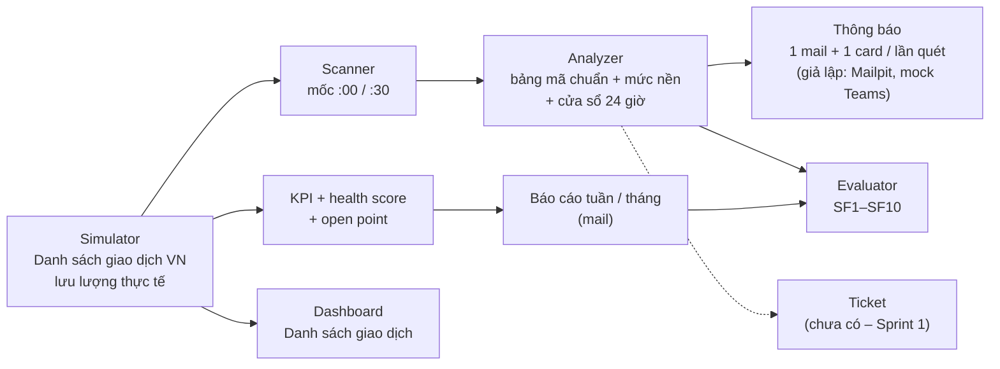

# Báo cáo Gate 1 – ASE: AI Agent hỗ trợ vận hành đổi pin VinFast

Nov 11, 2026 · @Khang

- **ASE là AI Agent hỗ trợ vận hành.** Giai đoạn này áp dụng vào **hệ thống BSS**, nguồn dữ liệu đầu tiên là **Danh sách giao dịch đổi pin**; hướng lâu dài là áp dụng cho nhiều hệ thống vận hành khác (mỗi hệ thống thêm nguồn dữ liệu và bảng mã lỗi riêng, phần quét, gộp sự cố, cảnh báo, KPI, báo cáo dùng lại).
- **Mã nguồn đo:** nhánh `ops-agent`, commit `8a871ce`. Ngày đo: 11/11/2026. Chạy lại: README hoặc mục Phụ lục.
- **Dữ liệu:** mock **VN** do simulator sinh, có ground truth, **lưu lượng đúng thực tế** (≈ 2,9 triệu giao dịch/tháng cho các điểm đổi pin VN, phân bổ theo tỉnh/thành). Mã trạm trong `eval` đã che (giữ tỉnh, số giả) vì bộ mock này dùng chung với đối tác; số đo trước và sau khi che giống hệt. **Agent không che mã:** với dữ liệu thật, mail, card, ticket và báo cáo gửi OPS luôn hiện đúng mã trạm/tủ có trong dữ liệu. **Cấu hình đo: rule-only**; LLM sẽ là V-LLM nội bộ (chưa có endpoint), nên SF6, SF9 chưa đo.
- **Thuật ngữ:** *SF* = chỉ tiêu chất lượng của AI. *KPI* = chỉ số vận hành của luồng đổi pin. *Sự cố* = nhóm giao dịch lỗi cùng nguyên nhân. *Lần quét* = một lần agent đọc danh sách giao dịch (30 phút/lần).

## 1. Tóm tắt

- **Bám lại đề bài:** ngoài phát hiện lỗi, ASE tính **KPI success factor** của luồng đổi pin, **health score cho 4 dịch vụ critical** và sinh **open point + đề xuất từ KPI**, gửi trong báo cáo tuần/tháng tự động (mục 3.2).
- **Chạy được từ đầu đến cuối:** simulator → agent quét 30 phút/lần → gộp sự cố → mail + card Teams (**cả hai đều giả lập**: Mailpit, mock Teams) → báo cáo tuần/tháng → dashboard. Chạy lại không gửi trùng.
- **Mock bám lưu lượng thực tế:** khoảng 96 nghìn giao dịch/ngày trên toàn quốc, TP.HCM và Hà Nội chiếm khoảng 40%, bình quân chỉ 2–3 giao dịch/điểm/ngày. Profile `scale` toàn quốc: agent quét cả một ngày (50 lần quét) trong 2,5 giây.
- **Baseline rule-only** trên **tập test mới chưa từng xem** của `eval` (seed 9142; 14.541 giao dịch, 936 lỗi/kẹt): **SF1, SF2, SF3, SF4a, SF5, SF7, SF8, SF10 đạt; SF4b 83,9%, sát ngưỡng 85% nhưng chưa đạt**. Mọi lần lặp có ≥ 2 giao dịch lỗi đều gộp đúng (20/20); 5 lần sai đều chỉ có 1 giao dịch lỗi.
- **Giả định rủi ro nhất chỉ đứng vững một phần (mục 4):** phát hiện và KPI làm được chỉ với các cột của màn hình; nhưng ở mật độ thật, sự cố tại một tủ chỉ để lại 1–5 giao dịch lỗi rải rác, nên gộp sự cố khó hơn nhiều. Lần đo đầu ở mật độ thật SF4b chỉ 55,9%; sau 2 sửa đổi (cộng dồn 24 giờ, nâng sự cố tủ lên mức trạm) đạt 83,9% trên tập test mới.
- **Lưu ý trung thực:** SF2/SF3 = 100% chủ yếu do cấu trúc mock. Các điều chỉnh rule được thiết kế trên `dev`; tập test cũ (seed 9042) đã bị xem trong lúc làm nên **đổi sang tập test mới (seed 9142) và chỉ đo một lần**, không chỉnh rule sau đó. Số đo trên mock do chính mình thiết kế không suy ra được kết quả trên dữ liệu thật.

**Kết luận.** Báo cáo đáp ứng 5 yêu cầu của Gate 1 và các điều kiện của Gate 0; SF4b chưa đạt sát ngưỡng, nguyên nhân đã đo (sự cố chỉ có 1 giao dịch lỗi) và có hướng xử lý.

## 2. Skeleton end-to-end

| Thành phần | Việc làm | Bằng chứng |
|---|---|---|
| Simulator (`ase/simulator/txn_generator.py`) | 1 dòng/giao dịch như màn hình thật. Trạm đặt tại điểm đổi pin VN thật, lấy mẫu phân tầng theo tỉnh; số giao dịch mỗi trạm theo tỉnh/thành (tỉnh nhiều điểm thì mỗi điểm đông hơn), tổng toàn quốc ≈ 2,9 triệu/tháng; cao điểm theo giờ địa phương. Lỗi chỉ dùng mã trong bảng chuẩn; 10 kịch bản (9 lỗi + 1 bẫy) | `dev` 450 điểm, 14.193 GD · `eval` 650 điểm, 43.683 GD · `scale` toàn quốc 96.498 GD/ngày; tất định theo seed |
| Bảng mã lỗi chuẩn | 66 mã, mức High/Low, dùng nguyên văn; code chỉ đọc | Test: 136 dòng gốc, 66 mã, 12 Low + 54 High |
| Scanner + Analyzer (`ase/agent/`) | Mỗi 30 phút tìm giao dịch Thất bại và kẹt (đứng yên > 10 phút) chưa báo; gộp sự cố: lan rộng nhiều trạm (theo mã hoặc dịch vụ critical) · nhiều tủ một trạm · một tủ. Lỗi mức tủ/trạm **cộng dồn qua các lần quét trong 24 giờ**; tủ thứ hai của cùng trạm lỗi khi tủ khác đang có sự cố → nâng lên sự cố mức trạm; mã Low chỉ thành sự cố khi vượt mức nền 7 ngày | `eval`: 1.442 lần quét trong ~11 giây; `scale`: 1 ngày toàn quốc trong 2,5 giây |
| Thông báo (`ase/notifier/scan_digest.py`) | 1 mail (kèm CSV) + 1 card mỗi lần quét có lỗi, gửi `ops@ase.local`; giờ địa phương trạm; chống gửi trùng theo lần quét | Mail trong Mailpit, card ở mock Teams (`/teams`). Chạy agent lần 2 trên cùng dữ liệu: không gửi thêm mail nào (chống gửi trùng) |
| KPI + báo cáo kỳ (`ase/report/`, `knowledge/kpi.yaml`) | KPI success factor, Top N lỗi (% trên tổng phiên lỗi, theo mẫu báo cáo OPS), health score dịch vụ critical, open point; tự lập 08:00 thứ Hai (tuần) và 08:00 ngày 1 (tháng) | `eval`: 5 báo cáo, khớp ground truth 5/5 |
| Dashboard (`/dashboard`) | Danh sách giao dịch (18 cột, bộ lọc, xuất CSV), Bản đồ trạm, Trạm & Tủ; cùng mã và cùng số liệu với agent | Test giao diện + API |
| Evaluator (`ase/evaluator/txn_eval.py`) | So với ground truth, ra bảng SF1–SF10 | `data/<profile>/agent/eval/report.md` |

**Kênh thông báo hiện là giả lập.** Mail gửi qua SMTP thật (`aiosmtplib`) nhưng tới **Mailpit**, máy chủ mail giả chạy trên máy (hộp thư `ops@ase.local`, xem tại `http://localhost:8025`), không tới hộp thư thật. Teams là **mock Teams**: trang web trong ASE (`/teams`) nhận và hiển thị Adaptive Card, vì chưa có quyền tạo webhook Teams. Chuyển sang kênh thật chỉ bằng cấu hình: mail đổi máy chủ SMTP trong `.env`; Teams cần URL webhook và `TeamsWebhookNotifier` (backlog việc 9).

**Chưa có trong skeleton: ticket.** Chưa tạo ticket, kể cả ticket giả lập; mail/card chưa có mã ticket. Analyzer đã giữ nguyên mã sự cố qua các lần quét (sự cố tái diễn → tăng revision), là nền cho quy tắc 1 ticket/sự cố. Kế hoạch: ticket giả lập (`MockTicketClient`) ở Sprint 1, việc 2 mục 6; ticket thật trên ManageEngine khi có portal trial (việc 9).

**Kết luận.** Phần đã có chạy bằng 3 lệnh trên laptop trong khoảng 1 phút (README).

## 3. Baseline metric (rule-only)

**Tập đo.** `eval`: 30 ngày, 650 điểm đổi pin VN thật (lấy mẫu theo tỉnh), 43.683 giao dịch (~1.450/ngày, đúng mật độ mỗi điểm như thực tế). Đo trên **10 ngày cuối** (split `test`, **seed 9142 mới, chưa từng xem**, khác seed `dev` 1042 và seed test cũ 9042): **14.541 giao dịch, 936 lỗi/kẹt** (923 Thất bại, 13 kẹt; 591 lỗi nền, 345 thuộc 31 lần lặp của 9 kịch bản lỗi). Rule viết và chỉnh trên `dev`.

### 3.1 Chỉ tiêu chất lượng của AI

| SF | Chỉ số | Ngưỡng | `eval` (test) | `dev` | Kết luận |
|---|---|---|---|---|---|
| SF1 | Giao dịch agent đọc được | 100% | 100% (43.683) | 100% (14.193) | đạt |
| SF2 | Recall lỗi + kẹt | ≥ 95% | 100% (936/936) | 100% (831/831) | đạt (do cấu trúc mock) |
| SF3 | Precision; giao dịch bẫy "chậm nhưng hoàn thành" bị báo | ≥ 90% | 100%; 0/5 | 100%; 0/5 | đạt (do cấu trúc mock) |
| SF4a | Mã + mức khớp bảng chuẩn | ≥ 85% | 100% | 100% | đạt |
| SF4b | Lần lặp kịch bản nằm trong đúng 1 sự cố | ≥ 85% | **83,9%** (26/31); lần lặp ≥ 2 lỗi: 100% (20/20) | 91,7% (22/24) | **chưa đạt** (sát ngưỡng) |
| SF5 | Lỗi → thông báo, p95 | ≤ 35 phút | **28,5 phút** (p50 15,3; max 30,0) | 28,9 phút | đạt (do nhịp quét 30 phút) |
| SF7 | Thông báo hợp lệ, đủ mã GD + giờ địa phương | 100% | 100% (812 thông báo) | 100% (321) | đạt |
| SF8 | Thông báo mỗi lần quét; ticket trùng | ≤ 1; 0 | 1 (812/1.442 lần quét); ticket: chưa đo | 1 (321/674) | đạt phần thông báo; ticket chưa có |
| SF10 | Báo cáo tuần/tháng khớp ground truth (tổng + từng mã) | 100% | 100% (5/5) | 100% (2/2) | đạt |
| SF6, SF9 | Gợi ý nguyên nhân; an toàn LLM | ≥ 70%; 0 | chưa đo | chưa đo | cần V-LLM |

**Đọc kết quả SF4b (chỉ số có ý nghĩa nhất)**

| Bước | `eval` (test) | `dev` | Thay đổi |
|---|---|---|---|
| Mock VN trước khi chỉnh lưu lượng (mỗi tủ 50–150 GD/ngày, chia đều) | 94,4% | 94,4% | — |
| **Mật độ thật**, rule cũ | **55,9%** (19/34) | 54,2% (13/24) | Sự cố tại một tủ chỉ có 1–5 lỗi rải rác trong cả ngày; rule cũ đòi ≥ 2 lỗi trong cùng một lần quét nên lỗi Low/không mã ở một tủ không bao giờ thành sự cố |
| Cộng dồn lỗi tủ/trạm qua các lần quét trong 24 giờ; sự cố tủ mở tới 3 ngày | 79,4% (27/34) | 87,5% (21/24) | Thiết kế và chỉnh trên `dev` |
| Nâng sự cố tủ lên mức trạm khi tủ khác cùng trạm đang có sự cố (mất điện trạm lộ ra ở từng tủ cách nhau vài giờ) | 85,3% (29/34) | 91,7% (22/24) | Thiết kế trên `dev`; cột test là tập cũ đã bị xem |
| **Tập test mới** (seed 9142), đo một lần, không chỉnh rule sau đó | **83,9%** (26/31) | — | Số chính thức của Gate 1 |

- 5 lần lặp còn sai trên tập test mới **đều chỉ có đúng 1 giao dịch lỗi** trong cả sự cố (một giao dịch Low/không mã thì không thể nhận ra là "sự cố" chỉ từ danh sách giao dịch). Mọi lần lặp có ≥ 2 giao dịch lỗi đều gộp đúng: **100% (20/20)**. Cách tính SF4b cho trường hợp 1 giao dịch cần chốt với mentor (không tự đổi định nghĩa).
- **Sự cố nhiễu:** 7/33 sự cố trên tập test mới, 3/25 trên `dev` chỉ gồm lỗi nền; tăng so với trước (2/33) vì cửa sổ cộng dồn 24 giờ đôi khi gom lỗi nền của cùng một tủ. Cần giảm ở Sprint 1.
- **Thông báo/ngày:** khoảng 27 mail/ngày (812 lần quét có lỗi trong 30 ngày), vì lần quét chỉ có lỗi lẻ vẫn gửi mail.

### 3.2 KPI success factor và health score (đầu ra cho OPS)

Báo cáo tháng 10/2026 trên `eval` (dữ liệu từ 05/10, lập tự động 08:00 ngày 01/11):

| KPI | Giá trị |
|---|---|
| Tổng giao dịch / tỷ lệ đổi pin thành công | 39.296 / 94,3% |
| Phiên lỗi (Thất bại + kẹt) | 2.241 (5,7%) |
| Thời gian một lần đổi p50 / p95 | 1 phút 13 giây / 1 phút 40 giây |
| Khách đã trả pin, chưa nhận pin mới | 248 |
| Khách bị ảnh hưởng (thất bại ≥ 2 lần/ngày) | 1.877 (16) |
| Top 5 lỗi | **85,85%** tổng phiên lỗi: D6031 BatteryInTimeout 35,88% · D6036 Payment Callback Timeout 16,38% · B0207 TxnUploadFailure 13,16% · D6033 InvalidBattery 10,66% · D6037 Payment Callback Failed 9,77% |

| Dịch vụ critical | Health score |
|---|---|
| Callback thanh toán (D6036, D6037) | 75,4 · Cần theo dõi |
| Đồng bộ giao dịch tủ → hệ thống (B0207) | 60,0 · Kém |
| Tủ / trạm | tính cho từng tủ, từng trạm; chỉ sinh open point khi đủ ≥ 50 giao dịch và ≥ 5 lỗi trong kỳ |

Health score = 100 − phạt theo % lỗi vượt mục tiêu − phạt theo % giao dịch có mã High (công thức và ngưỡng trong `kpi.yaml`, không để LLM chấm). Open point sinh từ KPI: 72 cái cho tháng 10 (mail hiện 10 cái ưu tiên cao nhất, CSV đủ), đứng đầu là hai dịch vụ toàn mạng và các tủ của kịch bản kẹt khoá / trả pin chưa nhận pin, mỗi cái có ảnh hưởng, bằng chứng (mã giao dịch thật) và đề xuất. **Đề xuất trong open point hiện là mẫu cố định theo loại open point (rule, tất định), chưa phải AI gợi ý**; phần AI gợi ý bằng V-LLM nội bộ (nhận xét, nguyên nhân khả nghi, việc nên làm, luôn trỏ tới số liệu và bằng chứng có thật) làm khi có V-LLM.

**Kết luận.** KPI và health score chỉ ra đúng các dịch vụ/tủ đã cài sự cố; gộp sự cố ở mật độ thật là điểm yếu chính cần xử lý ở Sprint 1.

## 4. Kiểm chứng giả định rủi ro nhất

**Giả định:** *chỉ với các cột của màn hình Danh sách giao dịch đổi pin và bảng mã lỗi chuẩn (không có nhóm lỗi, không có event từng bước, không có thanh toán), ở lưu lượng thực tế, agent phát hiện đủ lỗi, gộp được sự cố và tính được KPI success factor.*

| Câu hỏi | Kết quả | Căn cứ |
|---|---|---|
| Lỗi không có mã (lỗi im lặng)? | Giao dịch đứng ở Tạo mới / Đưa pin vào > 10 phút → "kẹt": 13/13 trên test, 0/5 bẫy bị báo | SF2, SF3 |
| Không có nhóm lỗi thì gộp sự cố bằng gì, ở mật độ thật? | Nơi xảy ra + mức nền + dịch vụ critical + cộng dồn 24 giờ + nâng lên mức trạm: 26/31 lần lặp ↔ 1 sự cố (**83,9%, chưa đạt 85%**); 100% lần lặp có ≥ 2 giao dịch lỗi | SF4b, mục 3.1 |
| KPI và health score tính được từ các cột này không? | Được, và khớp ground truth 5/5 báo cáo | SF10, mục 3.2 |
| Có chạy được ở quy mô toàn quốc không? | 96.498 GD/ngày: quét cả ngày 2,5 giây, sinh dữ liệu 14 giây (2 GB RAM) | Profile `scale` |
| Cần thêm trường nào ngoài màn hình? | Quốc gia + múi giờ (suy từ mã trạm); mã khách (đã băm) cho KPI khách bị ảnh hưởng | Model `SwapTransaction` |

**Phát hiện quan trọng:** ở mật độ thật, **sự cố tủ ngắn (vài giờ) gần như không để lại giao dịch nào** trong danh sách; danh sách giao dịch chỉ thấy được sự cố kéo dài (tới khi kỹ thuật xử lý) hoặc lan rộng. Muốn bắt sự cố tủ ngắn cần thêm nguồn cảnh báo của tủ (alarm/telemetry), không chỉ danh sách giao dịch.

**Rủi ro còn lại:** (1) dữ liệu masked có thể có mã chưa nằm trong bảng chuẩn → agent ghi "mã ngoài bảng chuẩn", không tự gán mức, bảng chuẩn giữ nguyên; (2) cách lấy danh sách thật (hiện chỉ thấy nút "Xuất dữ liệu"); (3) tỷ lệ lỗi nền thật có thể khác 4% → mức nền phải học từ lịch sử thật; (4) hệ số phân bổ giao dịch theo tỉnh là **giả định** (tỉnh nhiều điểm thì mỗi điểm đông hơn), cần số liệu thật theo tỉnh để hiệu chỉnh.

**Kết luận.** Giả định đứng vững cho phát hiện và KPI; gộp sự cố ở mật độ thật đạt 83,9%, sát ngưỡng; phần còn thiếu là sự cố chỉ để lại 1 giao dịch lỗi, việc đầu tiên của Sprint 1.

## 5. Xử lý góp ý Gate 0 và điều chỉnh kế hoạch

| Góp ý Gate 0 (09/11) | Đã làm (10–11/11) | Ở đâu |
|---|---|---|
| Rubric sai khung (100 điểm, 8 tiêu chí), thiếu tiêu chí 3, teamwork nằm trong rubric | Viết lại 3 tiêu chí × mức 2–3–4, mọi ô có số; tiêu chí 3 theo tiến độ / xử lý góp ý; teamwork tách riêng | `RUBRIC.md` |
| Lệch đề: success factor bị định nghĩa lại thành "kiểm tra giao dịch lỗi"; thiếu KPI, health score; open point chưa từ KPI | Tách hai lớp: **KPI success factor** của luồng đổi pin + **health score** 4 dịch vụ critical + open point từ KPI (đầu ra cho OPS); SF1–SF10 chỉ còn là chỉ tiêu chất lượng của AI | `ase/report/`, `kpi.yaml`, mục 3.2 |
| Phạm vi quá rộng: cắt còn VN, hoãn Kafka, đa quốc gia | Mock chỉ VN; Kafka và pipeline event 7 bước đóng băng | `profiles.yaml` |
| Không duyệt gửi dữ liệu lên API LLM ngoài; dùng model nội bộ, tách khỏi luồng ghi log | LLM = **V-LLM nội bộ**; mặc định rule-only; LLM bất đồng bộ, thông báo không chờ LLM; cấm LLM bên ngoài trong cấu hình | `config.py`, `.env.example` |
| Nhường detector realtime cho Nhân | Ghi rõ trong pair contract; detector event 7 bước của Khang đã đóng băng | `contracts/PAIR_CONTRACT_v0.1.md` |
| Pair contract hai bản lệch; thiếu schema chung, chiều baseline cho Nhân, metric cộng hưởng có ngưỡng | Một file v0.1 trong repo: phân tầng, **một schema sự kiện chung** (`ase.anomaly.event` v0.1, có contract test), chiều `baseline` Khang → Nhân, dữ liệu chung, ngày I1–I5, không dùng Kafka, 4 metric cộng hưởng có ngưỡng; đã gửi Nhân, chờ xác nhận | `contracts/` |
| Chưa có baseline thủ công của OPS | Cách đo (báo cáo Top N tháng, thời gian từ lỗi tới lúc OPS biết), đo trước CP2 | `RUBRIC.md` |
| Ngưỡng đo trên simulator tự thiết kế dễ tự khớp | Seed test riêng, kịch bản khoá trước; **lưu lượng mock theo số liệu thật** (2,9 triệu GD/tháng, theo tỉnh); ghi rõ giới hạn; đo lại trên mẫu masked gán nhãn | Mục 1, 3, 4 |
| Tài liệu quá dài | Kế hoạch 2 trang, chi tiết vào phụ lục | `KE_HOACH.md` |

Bản Gate 0 cập nhật (gói nộp lại + bảng này): `GATE0_v1.md`.

**Kết luận.** Các điều kiện của Gate 0 đã có phần sửa tương ứng; phần còn lại cần V-LLM, dữ liệu masked hoặc đối tác (xác nhận contract).

## 6. Backlog Sprint 1 (tới CP1 18/11)

| # | Việc | SF | Tiêu chí xong |
|---|---|---|---|
| 1 | **SF4b ở mật độ thật:** dùng thêm telemetry/alarm tủ (heartbeat, nhiệt độ) làm bằng chứng cho sự cố chỉ có 1 giao dịch lỗi; giảm sự cố nhiễu do cộng dồn 24 giờ (7/33); chốt với mentor cách tính lần lặp chỉ có 1 giao dịch lỗi | SF4 | `dev` ≥ 85% và tập test mới (seed khác 9142) ≥ 85%; sự cố nhiễu ≤ 2/33 |
| 2 | Ticket giả lập (`TicketClient`): 1 ticket/sự cố, tái diễn → ghi chú; mã ticket trong mail/card | SF8 | Ticket trùng = 0 |
| 3 | Lưu bền trạng thái quét để chạy liên tục (không chỉ phát lại) | SF8 | Tắt/bật agent không báo trùng |
| 4 | Mỗi lần đổi rule lớn: sinh thêm tập test chưa xem (đã làm một lần ở Gate 1 với seed 9142) | tất cả | Báo cáo trên tập chưa từng xem |
| 5 | I1 với Nhân: log sinh trên cùng trạm/tủ/giao dịch, ghi `baseline` và `transaction_incident` theo schema v0.1 | — | Contract test xanh ở hai repo |
| 6 | Adapter V-LLM nội bộ (khi có endpoint): giải thích sự cố và nhận xét báo cáo kỳ, chỉ dẫn evidence có thật, lỗi thì dùng bản rule | SF6, SF9 | Thông báo vẫn gửi khi LLM lỗi; evidence giả = 0 |
| 7 | Đo baseline thủ công của OPS; xin số giao dịch theo tỉnh để thay giả định phân bổ | Rubric TC1 | Có số trung vị ≥ 3 lần |
| 8 | `ExportFileSource`: đọc tệp "Xuất dữ liệu" CSV/XLSX + báo cáo coverage | SF1 | Chạy trên fixture cùng cột với màn hình |
| 9 | `ManageEngineClient`, `TeamsWebhookNotifier` | — | Khi có portal trial / URL webhook |

**Kết luận.** Việc 1–5 là đường găng của CP1; việc 6–9 phụ thuộc mentor hoặc bên ngoài.

## Phụ lục. Truy vết số liệu

| Số liệu | Nguồn |
|---|---|
| Mục 3.1, cột `eval` | `make sim PROFILE=eval` → `make agent-eval PROFILE=eval` → `data/eval/agent/eval/report.md` (split `test`) |
| Mục 3.1, cột `dev` | `make agent-eval PROFILE=dev` → `data/dev/agent/eval/report.md` |
| 936 = 923 + 13; 591 lỗi nền; 31 lần lặp (20 lần ≥ 2 lỗi), 9 kịch bản | `data/eval/txn_ground_truth.csv`, split `test` (seed 9142) |
| SF4b 94,4% (mock VN trước khi chỉnh lưu lượng), 55,9% (mật độ thật, rule cũ), 79,4% / 85,3% (tập test cũ seed 9042) | Commit `0a6439f`, `b55fbf6` và các lần chạy trong ngày 11/11 |
| Mục 3.2 | `data/eval/agent/reports/report-monthly-2026-10.json`; `make report PROFILE=eval FROM=2026-10-01 TO=2026-10-31` |
| Lưu lượng toàn quốc, 2,5 giây | `python -m ase.simulator --profile scale` → `python -m ase.agent --profile scale` |
| Cấu hình | `ase/simulator/profiles.yaml` (`txn_traffic`), `ase/knowledge/detector.yaml` (khối `scan`), `ase/knowledge/kpi.yaml`, `ase/simulator/txn_scenarios.yaml` |
